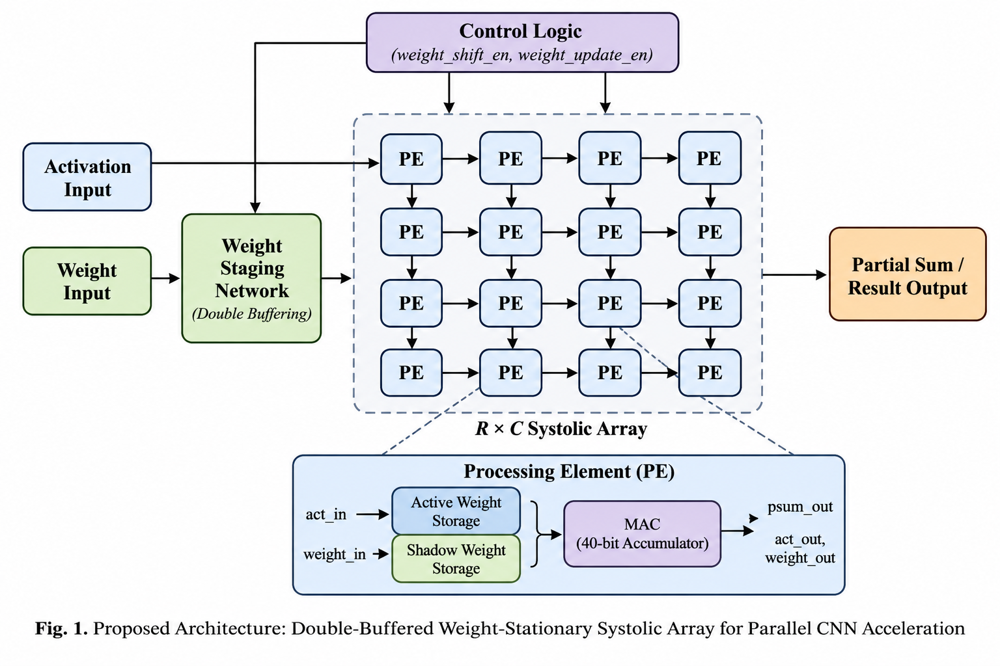
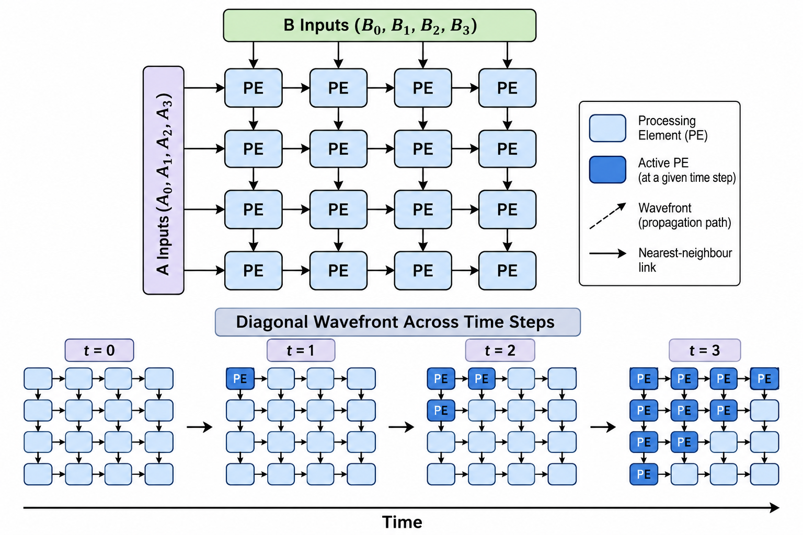

# 16×16 Double-Buffered Weight-Stationary Systolic Array Accelerator

A high-throughput, energy-efficient **16×16 2D Weight-Stationary (WS) Systolic Array Accelerator** designed in **SystemVerilog** for accelerating 2D Convolutional Neural Networks (CNNs) and General Matrix Multiplications (GEMM). 

Implemented and timing-closed on the **AMD / Xilinx Artix-7 FPGA (`xc7a200tfbg676-2`)** using **Yosys** and **AMD Vivado 2023.2**.



---

## Architectural Highlights

* **Decoupled Shadow-Register Double Buffering:** Each Processing Element (PE) contains two distinct weight registers: an active bank (`buf_D2`) driving the MAC compute engine and a shadow bank (`shadow_buf_D2`) preloading the subsequent weight tile in the background. This completely hides weight-reload latency and eliminates memory stall cycles.
* **Synchronized Atomic Bank Switching:** A unified control pulse (`weight_update_en`) triggers a single-cycle transfer from shadow registers to active registers across tile boundaries, guarded by pipeline-drain interlocks.
* **40-Bit Overflow-Proof Accumulator:** 16-bit signed activations and 16-bit signed weights are accumulated along columns into a 40-bit partial-sum datapath. The 8 guard bits provide complete overflow protection for up to 256 consecutive accumulations ($16 \times 16$).
* **Wavefront Skew Scheduling:** Activations stream West-to-East with a 1-cycle per row diagonal skew, aligning activation streams perfectly with descending column partial-sums.
* **High-Efficiency 2D Mesh:** Synthesized with localized nearest-neighbor interconnects, eliminating global high-capacitance routing bottlenecks.



---

## FPGA Implementation & Performance Metrics

Synthesized and placed & routed targeting the **AMD Xilinx Artix-7 FPGA (`xc7a200tfbg676-2`, Speed Grade -2)** in Vivado 2023.2:

### Throughput & Performance Summary
| Metric | Value | Description / Derivation |
| :--- | :--- | :--- |
| **Clock Frequency ($f_{clk}$)** | **232.558 MHz** | Clock period $T_{clk} = 4.300\text{ ns}$ |
| **Array Dimensions** | **16 × 16** | 256 Processing Elements (PEs) |
| **Peak Compute Throughput** | **119.07 GOPS** | $2 \times R \times C \times f_{clk} = 2 \times 256 \times 232.558\text{ MHz}$ |
| **Peak MAC Rate** | **59.535 GMAC/s** | $16 \times 16 \times 232.558\text{ MHz}$ |
| **Sustained Throughput** | **45.2 – 55.4 GMAC/s** | Over complete GEMM tiles ($76\%$ to $93\%$ sustained PE efficiency) |
| **Worst Negative Slack (WNS)** | **$+0.081\text{ ns}$** | **Setup Timing Met** at 232.56 MHz ($T_{clk} = 4.30\text{ ns}$) |

### Post-Implementation Resource Utilization (Vivado Routed)
| Resource | Used | Available | Utilization % |
| :--- | :--- | :--- | :--- |
| **DSP48E1 Slices** | **256** | 740 | **34.59%** (1 DSP dedicated per PE) |
| **Slice Registers (FFs)** | **27,250** | 269,200 | **10.12%** |
| **Slice LUTs** | **9,743** | 133,800 | **7.28%** |

*(Detailed reports are available in the [`reports/`](reports/) directory).*

---

## Directory Organization

```
├── src/                          # Synthesizable SystemVerilog RTL
│   ├── sys_array.sv              # Parameterized 2D R x C Systolic Array top module
│   ├── PE.sv                     # Processing Element with double-buffered weight registers
│   └── mac.sv                    # PE arithmetic datapath (16-bit MAC + 40-bit accumulator)
├── sim/                          # Verification testbenches & filelists
│   ├── sys_array_tb.sv           # Comprehensive array testbench (wavefront matrix tests)
│   ├── mac_tb.sv                 # Standalone PE unit testbench
│   ├── sources_sys_array.f       # Relative filelist for array simulation
│   └── sources_mac.f             # Relative filelist for PE simulation
├── synth/                        # Synthesis & Implementation scripts
│   ├── synth_fpga.ys             # Yosys FPGA synthesis script for Artix-7
│   ├── run_sta.tcl               # Vivado batch place, route, and STA script
│   └── sys_array_timing.xdc      # XDC timing constraints
├── reports/                      # Official sign-off implementation reports
│   ├── post_synth_timing.rpt     # Routed timing report (WNS +0.081 ns)
│   ├── post_synth_utilization.rpt# Routed resource utilization report
│   └── systolic_array_metrics.txt# Architectural throughput & latency derivation
├── docs/                         # Architecture diagrams and specifications
│   ├── double_buffered_ws_array.png
│   └── wavefront_dataflow.png
├── Makefile                      # Automated Verilator build and simulation recipes
├── .gitignore                    # Git rules filtering netlists, waveforms, and build objects
└── README.md
```

---

## Verification & Simulation

### Build and Run with Verilator:
```bash
# 1. Compile simulation executable
make sim

# 2. Run simulation
make run

# 3. Clean temporary build objects
make clean
```

---

## FPGA Synthesis & Static Timing Analysis

### 1. Synthesize with Yosys:
```bash
yosys -s synth/synth_fpga.ys
```

### 2. Run Place, Route, & STA in AMD Vivado (Batch Mode):
```bash
vivado -mode batch -source synth/run_sta.tcl
```

---

## Author
**Venkata Ganesh Akula**  
* Department of Electronics & Communication Engineering, RGUKT Nuzvid  
* Email: ganeshakula10.8.5@gmail.com  
* GitHub: [@ganeshakula-2005](https://github.com/ganeshakula-2005)
